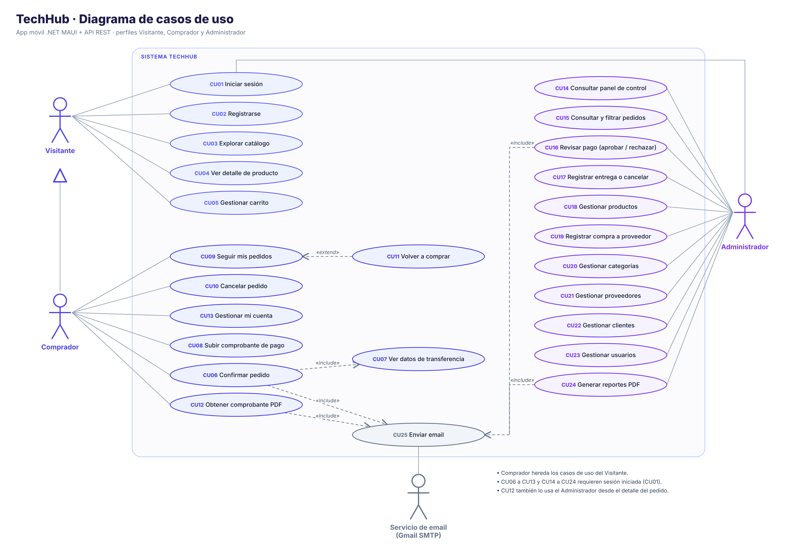

# TechHub · Casos de uso

Sistema de gestión comercial para una tienda de hardware y componentes de PC.
Una app móvil (.NET MAUI, Android) consume una API REST (ASP.NET Core 10 + SQL Server).

## Actores

| Actor | Tipo | Descripción |
|---|---|---|
| **Visitante** | Principal | Persona que usa la app sin cuenta. Puede ver el catálogo y armar el carrito. |
| **Comprador** | Principal | Cliente registrado (rol `Comprador`). Hereda todo lo del Visitante y además compra y sigue sus pedidos. |
| **Administrador** | Principal | Responsable de la tienda (rol `Admin`). Gestiona catálogo, stock, pedidos, pagos, maestros y reportes. |
| **Servicio de email** | Secundario | Gmail por SMTP (contraseña de aplicación). Recibe los correos que genera el sistema. |

## Resumen

| CU | Nombre | Actor | Endpoints principales |
|---|---|---|---|
| CU01 | Iniciar sesión | Visitante, Administrador | `POST /api/auth/login` |
| CU02 | Registrarse | Visitante | `POST /api/auth/registro` |
| CU03 | Explorar catálogo | Visitante | `GET /api/productos`, `GET /api/categorias` |
| CU04 | Ver detalle de producto | Visitante | `GET /api/productos/{id}`, `GET /api/productos/{id}/relacionados` |
| CU05 | Gestionar carrito | Visitante | (local en la app) |
| CU06 | Confirmar pedido | Comprador | `POST /api/pedidos` |
| CU07 | Ver datos de transferencia | Comprador (incluido en CU06) | `GET /api/pagos/transferencia` |
| CU08 | Subir comprobante de pago | Comprador | `POST /api/pedidos/{codigo}/comprobante` |
| CU09 | Seguir mis pedidos | Comprador | `GET /api/pedidos/mios`, `GET /api/pedidos/{codigo}` |
| CU10 | Cancelar pedido | Comprador | `POST /api/pedidos/{codigo}/cancelar` |
| CU11 | Volver a comprar | Comprador (extiende CU09) | (carrito local) |
| CU12 | Obtener comprobante PDF del pedido | Comprador, Administrador | `GET /api/reportes/pedido/{codigo}`, `POST /api/reportes/enviar` |
| CU13 | Gestionar mi cuenta | Comprador | `GET /api/auth/perfil`, `PUT /api/auth/perfil` |
| CU14 | Consultar panel de control | Administrador | `GET /api/dashboard/resumen`, `/ventas-diarias`, `/top-productos` |
| CU15 | Consultar y filtrar pedidos | Administrador | `GET /api/pedidos?estado=` |
| CU16 | Revisar pago (aprobar / rechazar) | Administrador | `GET /api/pedidos/{codigo}/comprobante`, `PUT /api/pedidos/{codigo}/estado`, `POST /api/pedidos/{codigo}/rechazar-pago` |
| CU17 | Registrar entrega o cancelar pedido | Administrador | `PUT /api/pedidos/{codigo}/estado` |
| CU18 | Gestionar productos | Administrador | `POST/PUT/DELETE /api/productos`, `POST/DELETE /api/productos/{id}/imagen` |
| CU19 | Registrar compra a proveedor | Administrador | `GET/POST /api/ingresos` |
| CU20 | Gestionar categorías | Administrador | `/api/categorias` |
| CU21 | Gestionar proveedores | Administrador | `/api/proveedores` |
| CU22 | Gestionar clientes | Administrador | `/api/clientes` |
| CU23 | Gestionar usuarios | Administrador | `/api/usuarios` |
| CU24 | Generar reportes PDF | Administrador | `GET /api/reportes/inventario`, `GET /api/reportes/ventas`, `POST /api/reportes/enviar` |
| CU25 | Enviar email | Sistema → Servicio de email | (cola interna `EmailBackgroundService`) |

Estados de un pedido: **Pendiente** (esperando pago) → **EnRevision** (pago en revisión) → **Confirmado** (pago confirmado) → **Entregado**. Desde Pendiente, EnRevision o Confirmado puede pasar a **Cancelado**, y el stock vuelve al inventario.

---

## Especificación

### CU01 · Iniciar sesión
- **Actores:** Visitante (pasa a ser Comprador), Administrador.
- **Precondición:** el usuario tiene una cuenta activa.
- **Flujo principal:**
  1. El usuario ingresa su nombre de usuario o email y su contraseña.
  2. La API verifica la contraseña (hash con `PasswordHasher`) y devuelve un token JWT firmado con HMAC-SHA256, que incluye el id, el nombre y el rol.
  3. La app guarda el token en `SecureStorage`.
  4. La app muestra la sección según el rol: la tienda para el Comprador, el panel para el Administrador.
- **Flujos alternativos:**
  - **Datos incorrectos o cuenta inactiva:** se muestra "Usuario o contraseña incorrectos".
  - **El usuario venía del carrito:** después de iniciar sesión vuelve al carrito.
- **Postcondición:** las siguientes llamadas a la API llevan el header `Authorization: Bearer <token>`.

### CU02 · Registrarse
- **Actor:** Visitante.
- **Flujo principal:**
  1. El visitante completa nombre, DNI/CUIT, email, contraseña (mínimo 6 caracteres) y, si quiere, teléfono y dirección.
  2. La API valida los datos.
  3. La API crea, en una misma transacción, la ficha de **Cliente** y la cuenta de **Usuario** con rol Comprador.
  4. La API devuelve el token y la sesión queda iniciada.
- **Flujos alternativos:**
  - **Email o DNI/CUIT ya registrado:** la API responde 409 y la app muestra el aviso.
  - **DNI/CUIT con formato inválido:** la app muestra el error de validación.
- **Postcondición:** el visitante pasa a ser Comprador.

### CU03 · Explorar catálogo
- **Actor:** Visitante.
- **Flujo principal:**
  1. La app muestra los productos destacados y el catálogo paginado.
  2. El usuario puede buscar por texto, filtrar por categoría (chips) y por rango de precio, y ordenar por nombre, más vendidos, novedades o precio.
  3. Cada tarjeta muestra la foto, el precio y el estado de stock (disponible, "¡Quedan N!" o sin stock).
- **Flujo alternativo:** desde la tarjeta, el botón **+** agrega el producto al carrito (compra rápida, ver CU05).

### CU04 · Ver detalle de producto
- **Actor:** Visitante.
- **Flujo principal:**
  1. El usuario toca un producto.
  2. La app muestra la foto, marca, categoría, descripción, precio y stock.
  3. El usuario elige la cantidad y lo agrega al carrito.
  4. Abajo se ven productos relacionados de la misma categoría.
- **Restricción:** no se pueden agregar más unidades que el stock disponible.

### CU05 · Gestionar carrito
- **Actor:** Visitante.
- **Flujo principal:** el usuario agrega, suma, resta o quita productos. El total se recalcula en el momento. El carrito se guarda en el dispositivo y su cantidad se ve en la pestaña.

### CU06 · Confirmar pedido
- **Actor:** Comprador.
- **Precondición:** el carrito tiene productos. Si no hay sesión iniciada, la app lleva a CU01 y después vuelve al carrito.
- **Flujo principal:**
  1. El comprador revisa el carrito.
  2. Se muestran los datos de transferencia (CU07).
  3. El comprador confirma.
  4. La API registra una **Salida** por ítem, todas con el mismo `CodigoPedido` y en estado **Pendiente**. Descuenta y reserva el stock con un `UPDATE` condicional dentro de una transacción.
  5. Se encola el email "Pedido recibido" con los datos para transferir (CU25).
  6. La app muestra la confirmación y abre el detalle del pedido.
- **Flujo alternativo:** si otro usuario compró antes y no alcanza el stock, la API responde 409 y no se registra nada. La restricción `CHECK (Stock >= 0)` impide stock negativo.
- **Postcondición:** el pedido queda Pendiente y el stock queda reservado.

### CU07 · Ver datos de transferencia
- **Actor:** Comprador (incluido en CU06 y visible en el detalle del pedido).
- **Flujo principal:** la app muestra alias, CBU/CVU, titular, CUIT, banco y las horas de reserva del stock (configurados en `appsettings`). El comprador puede copiar el alias o el CBU con un toque.

### CU08 · Subir comprobante de pago
- **Actor:** Comprador.
- **Precondición:** el pedido está en estado Pendiente.
- **Flujo principal:**
  1. Desde el detalle del pedido, el comprador elige una foto o un PDF del comprobante (JPG, PNG, WebP o PDF; máximo 5 MB).
  2. La API valida la extensión y el contenido real del archivo (sus primeros bytes).
  3. La API guarda el archivo en una carpeta privada (`App_Data/comprobantes`) y pasa el pedido a **EnRevision**.
- **Flujo alternativo:** si el archivo no es válido o es muy grande, la API responde 400 con el motivo.
- **Postcondición:** el Administrador ve el pedido en "Pagos a revisar".

### CU09 · Seguir mis pedidos
- **Actor:** Comprador.
- **Flujo principal:**
  1. La app lista los pedidos del comprador (paginados), con código, fecha, total y estado de color.
  2. Al abrir uno se ve una línea de tiempo de 4 pasos (pedido realizado, pago enviado, pago confirmado, entregado), los ítems y los datos de pago.
- **Flujo alternativo:** si el pago fue rechazado, se muestra el motivo y se puede subir otro comprobante (CU08).

### CU10 · Cancelar pedido
- **Actor:** Comprador.
- **Precondición:** el pedido está en estado Pendiente o EnRevision.
- **Flujo principal:** el comprador confirma la cancelación, el pedido pasa a **Cancelado** y las unidades vuelven al stock.

### CU11 · Volver a comprar
- **Actor:** Comprador (extiende CU09).
- **Flujo principal:** desde un pedido anterior, el comprador carga en el carrito los mismos productos que siguen activos y con stock, y la app lo lleva al carrito.

### CU12 · Obtener comprobante PDF del pedido
- **Actores:** Comprador y Administrador.
- **Flujo principal:**
  1. La API genera el PDF del pedido con QuestPDF.
  2. El usuario puede abrirlo, compartirlo (WhatsApp, Drive, etc.) o enviarlo por email a la dirección que indique (CU25).
- **Restricción:** un comprador solo puede obtener el PDF de sus propios pedidos.

### CU13 · Gestionar mi cuenta
- **Actor:** Comprador.
- **Flujo principal:** el comprador modifica nombre, teléfono y dirección. Opcionalmente cambia la contraseña ingresando la actual. También puede cerrar sesión.

### CU14 · Consultar panel de control
- **Actor:** Administrador.
- **Flujo principal:** el panel muestra:
  - pagos a revisar y pedidos esperando pago;
  - facturación del día y del mes (solo pagos confirmados);
  - unidades y valor del inventario;
  - gráfico de ventas de los últimos 7 días;
  - ranking de los productos más vendidos;
  - productos por debajo del stock mínimo.

### CU15 · Consultar y filtrar pedidos
- **Actor:** Administrador.
- **Flujo principal:** el administrador ve todos los pedidos (paginados) y los filtra por estado: Esperando pago, Pago en revisión, Pago confirmado, Entregado o Cancelado.

### CU16 · Revisar pago (aprobar / rechazar)
- **Actor:** Administrador.
- **Precondición:** el pedido está en EnRevision.
- **Flujo principal:**
  1. El administrador abre el comprobante subido por el cliente.
  2. Si la transferencia ingresó, toca **Aprobar** y el pedido pasa a **Confirmado**.
  3. Se encola el email "Pago confirmado" con el comprobante del pedido en PDF adjunto (CU25).
- **Flujo alternativo:** el administrador toca **Rechazar** e ingresa el motivo. El pedido vuelve a **Pendiente** y el comprador ve el motivo.

### CU17 · Registrar entrega o cancelar pedido
- **Actor:** Administrador.
- **Flujo principal:** un pedido Confirmado se marca como **Entregado** y la venta queda cerrada.
- **Flujo alternativo:** el administrador cancela un pedido que todavía no fue entregado y el stock vuelve al inventario.
- **Regla:** la API solo permite las transiciones de estado válidas (`EstadosPedido.TransicionValida`).

### CU18 · Gestionar productos
- **Actor:** Administrador.
- **Flujo principal:** el administrador da de alta, edita o da de baja (baja lógica, `Activo = false`) un producto: nombre, marca, categoría, precio, stock mínimo y descripción.
- **Fotos:** la foto se sube desde la galería. La API la guarda en `wwwroot/uploads` con un nombre GUID y valida tipo y tamaño. También se puede quitar.
- **Regla:** el stock no se edita a mano. Entra por CU19 y sale por los pedidos, para que quede la trazabilidad.

### CU19 · Registrar compra a proveedor
- **Actor:** Administrador.
- **Flujo principal:**
  1. El administrador elige el producto y el proveedor, e ingresa cantidad, costo unitario y número de comprobante.
  2. La API registra un **Ingreso**, suma el stock en la misma transacción y guarda qué usuario lo registró.

### CU20 · Gestionar categorías
- **Actor:** Administrador.
- **Flujo principal:** el administrador da de alta, edita y elimina categorías. El nombre es único.
- **Regla:** no se puede eliminar una categoría que tiene productos.

### CU21 · Gestionar proveedores
- **Actor:** Administrador.
- **Flujo principal:** el administrador da de alta, edita y da de baja (baja lógica) proveedores. El CUIT es único.

### CU22 · Gestionar clientes
- **Actor:** Administrador.
- **Flujo principal:** el administrador da de alta, edita y da de baja (baja lógica) clientes. El DNI/CUIT es único.

### CU23 · Gestionar usuarios
- **Actor:** Administrador.
- **Flujo principal:** el administrador da de alta, edita (rol, datos, contraseña) y da de baja (baja lógica) usuarios. El nombre de usuario y el email son únicos.

### CU24 · Generar reportes PDF
- **Actor:** Administrador.
- **Flujo principal:**
  1. El administrador elige el reporte:
     - **Inventario valorizado:** stock, mínimo, precio y valor de cada producto a precio de venta.
     - **Ventas por período:** últimos 7 o 30 días, el mes actual o un rango de fechas a elección.
  2. La API genera el PDF.
  3. El administrador lo abre, lo comparte o lo envía por email (CU25).

### CU25 · Enviar email
- **Actores:** sistema → Servicio de email (Gmail SMTP).
- **Disparadores:** pedido recibido (CU06), pago confirmado (CU16), envío de un PDF (CU12 y CU24).
- **Flujo principal:**
  1. El mensaje entra en una cola en memoria (`Channel`).
  2. Un `BackgroundService` lo envía con MailKit (STARTTLS, puerto 587) y una contraseña de aplicación de Gmail.
  3. Si el envío falla, se registra en el log y la operación del usuario no se interrumpe.
- **Configuración:** sección `Email` de `appsettings`. Se puede desactivar con `Habilitado: false`.
