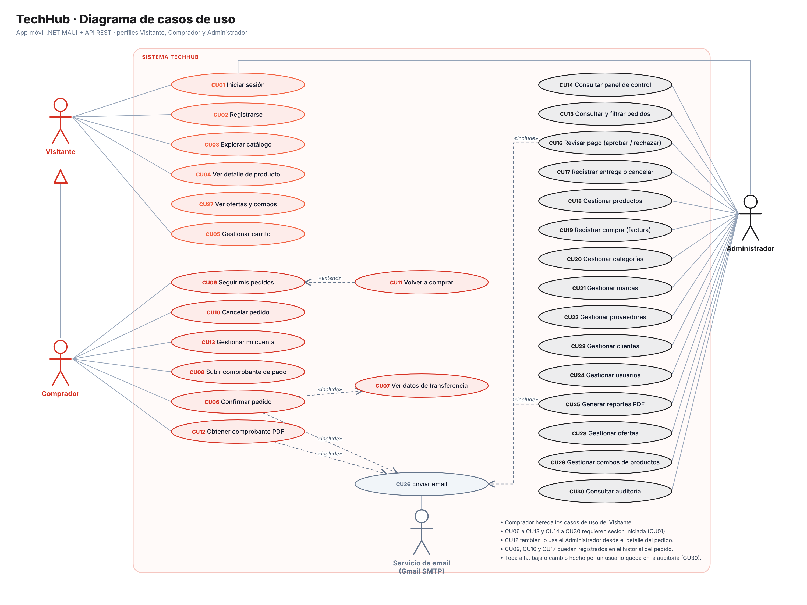

# TechHub · Casos de uso

Sistema de gestión comercial para una tienda de hardware y componentes de PC.
Una app móvil (.NET MAUI, Android) consume una API REST (ASP.NET Core 10 + SQL Server).

## Actores

| Actor | Tipo | Descripción |
|---|---|---|
| **Visitante** | Principal | Persona que usa la app sin cuenta. Puede ver el catálogo y armar el carrito. |
| **Comprador** | Principal | Cliente registrado (rol `Comprador`). Hereda todo lo del Visitante y además compra y sigue sus pedidos. |
| **Administrador** | Principal | Responsable de la tienda (rol `Admin`). Gestiona catálogo, stock, pedidos, pagos, maestros y reportes. |
| **Servicio de email** | Secundario | Gmail por SMTP (contraseña de aplicación). Recibe los correos que genera el sistema. |

## Resumen

| CU | Nombre | Actor | Endpoints principales |
|---|---|---|---|
| CU01 | Iniciar sesión | Visitante, Administrador | `POST /api/auth/login` |
| CU02 | Registrarse | Visitante | `POST /api/auth/registro` |
| CU03 | Explorar catálogo | Visitante | `GET /api/productos`, `GET /api/categorias`, `GET /api/marcas` |
| CU04 | Ver detalle de producto | Visitante | `GET /api/productos/{id}`, `GET /api/productos/{id}/relacionados` |
| CU05 | Gestionar carrito | Visitante | (local en la app) |
| CU06 | Confirmar pedido | Comprador | `POST /api/pedidos` |
| CU07 | Ver datos de transferencia | Comprador (incluido en CU06) | `GET /api/pagos/transferencia` |
| CU08 | Subir comprobante de pago | Comprador | `POST /api/pedidos/{codigo}/comprobante` |
| CU09 | Seguir mis pedidos | Comprador | `GET /api/pedidos/mios`, `GET /api/pedidos/{codigo}` |
| CU10 | Cancelar pedido | Comprador | `POST /api/pedidos/{codigo}/cancelar` |
| CU11 | Volver a comprar | Comprador (extiende CU09) | (carrito local) |
| CU12 | Obtener comprobante PDF del pedido | Comprador, Administrador | `GET /api/reportes/pedido/{codigo}`, `POST /api/reportes/enviar` |
| CU13 | Gestionar mi cuenta | Comprador | `GET /api/auth/perfil`, `PUT /api/auth/perfil` |
| CU14 | Consultar panel de control | Administrador | `GET /api/dashboard/resumen`, `/ventas-diarias`, `/top-productos`, `/ventas-por-marca` |
| CU15 | Consultar y filtrar pedidos | Administrador | `GET /api/pedidos?estado=` |
| CU16 | Revisar pago (aprobar / rechazar) | Administrador | `GET /api/pedidos/{codigo}/comprobante`, `PUT /api/pedidos/{codigo}/estado`, `POST /api/pedidos/{codigo}/rechazar-pago` |
| CU17 | Registrar entrega o cancelar pedido | Administrador | `PUT /api/pedidos/{codigo}/estado` |
| CU18 | Gestionar productos | Administrador | `POST/PUT/DELETE /api/productos`, `POST/DELETE /api/productos/{id}/imagen`, `POST /api/marcas` |
| CU19 | Registrar compra a proveedor (factura) | Administrador | `GET/POST /api/compras` |
| CU20 | Gestionar categorías | Administrador | `/api/categorias` |
| CU21 | Gestionar marcas | Administrador | `/api/marcas` |
| CU22 | Gestionar proveedores | Administrador | `/api/proveedores` |
| CU23 | Gestionar clientes | Administrador | `/api/clientes` |
| CU24 | Gestionar usuarios | Administrador | `/api/usuarios`, `GET /api/roles` |
| CU25 | Generar reportes PDF | Administrador | `GET /api/reportes/inventario`, `GET /api/reportes/ventas`, `POST /api/reportes/enviar` |
| CU26 | Enviar email | Sistema → Servicio de email | (cola interna `EmailBackgroundService`) |
| CU27 | Ver ofertas y combos | Visitante | `GET /api/productos?soloOfertas=true`, `GET /api/combos`, `GET /api/combos/{id}` |
| CU28 | Gestionar ofertas | Administrador | `/api/ofertas` |
| CU29 | Gestionar combos de productos | Administrador | `/api/combos` |
| CU30 | Consultar auditoría | Administrador | `GET /api/auditoria`, `GET /api/auditoria/entidades` |

Estados de un pedido (tabla **EstadosPedido**): **Pendiente** (esperando pago) → **EnRevision** (pago en revisión) → **Confirmado** (pago confirmado) → **Entregado**. Desde Pendiente, EnRevision o Confirmado puede pasar a **Cancelado**, y el stock vuelve al inventario. Cada cambio queda registrado en **HistorialPedidos** con la fecha, el usuario que lo hizo y un comentario opcional (`GET /api/estados-pedido` lista los estados).

---

## Especificación

### CU01 · Iniciar sesión
- **Actores:** Visitante (pasa a ser Comprador), Administrador.
- **Precondición:** el usuario tiene una cuenta activa.
- **Flujo principal:**
  1. El usuario ingresa su nombre de usuario o email y su contraseña.
  2. La API verifica la contraseña (hash con `PasswordHasher`) y devuelve un token JWT firmado con HMAC-SHA256, que incluye el id, el nombre y el rol.
  3. La app guarda el token en `SecureStorage`.
  4. La app muestra la sección según el rol: la tienda para el Comprador, el panel para el Administrador.
- **Flujos alternativos:**
  - **Datos incorrectos o cuenta inactiva:** se muestra "Usuario o contraseña incorrectos".
  - **El usuario venía del carrito:** después de iniciar sesión vuelve al carrito.
- **Postcondición:** las siguientes llamadas a la API llevan el header `Authorization: Bearer <token>`.

### CU02 · Registrarse
- **Actor:** Visitante.
- **Flujo principal:**
  1. El visitante completa nombre, DNI/CUIT, email, contraseña (mínimo 6 caracteres) y, si quiere, teléfono y dirección.
  2. La API valida los datos.
  3. La API crea, en una misma transacción, la ficha de **Cliente** y la cuenta de **Usuario** con rol Comprador.
  4. La API devuelve el token y la sesión queda iniciada.
- **Flujos alternativos:**
  - **Email o DNI/CUIT ya registrado:** la API responde 409 y la app muestra el aviso.
  - **DNI/CUIT con formato inválido:** la app muestra el error de validación.
- **Postcondición:** el visitante pasa a ser Comprador.

### CU03 · Explorar catálogo
- **Actor:** Visitante.
- **Flujo principal:**
  1. La app muestra los productos destacados y el catálogo paginado.
  2. El usuario puede buscar por texto o marca, filtrar por categoría (chips rellenos), por marca (chips contorneados) y por rango de precio, y ordenar por nombre, más vendidos, novedades o precio.
  3. Cada tarjeta muestra la foto, el precio y el estado de stock (disponible, "¡Quedan N!" o sin stock).
- **Flujo alternativo:** desde la tarjeta, el botón **+** agrega el producto al carrito (compra rápida, ver CU05).

### CU04 · Ver detalle de producto
- **Actor:** Visitante.
- **Flujo principal:**
  1. El usuario toca un producto.
  2. La app muestra la foto, marca, categoría, descripción, precio y stock.
  3. El usuario elige la cantidad y lo agrega al carrito.
  4. Abajo se ven productos relacionados de la misma categoría.
  5. Si el producto tiene una oferta vigente, se muestra el precio con descuento, el precio de lista tachado y la etiqueta con el porcentaje.
- **Restricción:** no se pueden agregar más unidades que el stock disponible.

### CU05 · Gestionar carrito
- **Actor:** Visitante.
- **Flujo principal:** el usuario agrega, suma, resta o quita productos. El total se recalcula en el momento. El carrito se guarda en el dispositivo y su cantidad se ve en la pestaña.

### CU06 · Confirmar pedido
- **Actor:** Comprador.
- **Precondición:** el carrito tiene productos. Si no hay sesión iniciada, la app lleva a CU01 y después vuelve al carrito.
- **Flujo principal:**
  1. El comprador revisa el carrito (puede incluir productos sueltos y combos).
  2. Se muestran los datos de transferencia (CU07).
  3. El comprador confirma.
  4. La API registra el **Pedido** (cabecera, estado **Pendiente**) con un renglón en **DetallesPedido** por producto (los combos se expanden en sus productos, cada uno con el precio con descuento del combo), y el primer paso en **HistorialPedidos**. Descuenta y reserva el stock con un `UPDATE` condicional, todo dentro de una transacción.
  5. Se encola el email "Pedido recibido" con los datos para transferir (CU26).
  6. La app muestra la confirmación y abre el detalle del pedido.
- **Flujo alternativo:** si otro usuario compró antes y no alcanza el stock, la API responde 409 y no se registra nada. La restricción `CHECK (Stock >= 0)` impide stock negativo.
- **Postcondición:** el pedido queda Pendiente y el stock queda reservado.

### CU07 · Ver datos de transferencia
- **Actor:** Comprador (incluido en CU06 y visible en el detalle del pedido).
- **Flujo principal:** la app muestra alias, CBU/CVU, titular, CUIT, banco y las horas de reserva del stock (configurados en `appsettings`). El comprador puede copiar el alias o el CBU con un toque.

### CU08 · Subir comprobante de pago
- **Actor:** Comprador.
- **Precondición:** el pedido está en estado Pendiente.
- **Flujo principal:**
  1. Desde el detalle del pedido, el comprador elige una foto o un PDF del comprobante (JPG, PNG, WebP o PDF; máximo 5 MB).
  2. La API valida la extensión y el contenido real del archivo (sus primeros bytes).
  3. La API guarda el archivo en una carpeta privada (`App_Data/comprobantes`) y pasa el pedido a **EnRevision**.
- **Flujo alternativo:** si el archivo no es válido o es muy grande, la API responde 400 con el motivo.
- **Postcondición:** el Administrador ve el pedido en "Pagos a revisar".

### CU09 · Seguir mis pedidos
- **Actor:** Comprador.
- **Flujo principal:**
  1. La app lista los pedidos del comprador (paginados), con código, fecha, total y estado de color.
  2. Al abrir uno se ve una línea de tiempo de 4 pasos (pedido realizado, pago enviado, pago confirmado, entregado) con la **fecha y hora real** de cada paso, los ítems y los datos de pago.
  3. Debajo, el **historial del pedido** muestra cada cambio de estado con fecha, quién lo hizo ("por vos" o "por la tienda") y el comentario, si lo hay.
- **Flujo alternativo:** si el pago fue rechazado, se muestra el motivo (también queda en el historial, aunque se rechace más de una vez) y se puede subir otro comprobante (CU08).

### CU10 · Cancelar pedido
- **Actor:** Comprador.
- **Precondición:** el pedido está en estado Pendiente o EnRevision.
- **Flujo principal:** el comprador confirma la cancelación, el pedido pasa a **Cancelado** y las unidades vuelven al stock.

### CU11 · Volver a comprar
- **Actor:** Comprador (extiende CU09).
- **Flujo principal:** desde un pedido anterior, el comprador carga en el carrito los mismos productos que siguen activos y con stock, y la app lo lleva al carrito.

### CU12 · Obtener comprobante PDF del pedido
- **Actores:** Comprador y Administrador.
- **Flujo principal:**
  1. La API genera el PDF del pedido con QuestPDF.
  2. El usuario puede abrirlo, compartirlo (WhatsApp, Drive, etc.) o enviarlo por email a la dirección que indique (CU26).
- **Restricción:** un comprador solo puede obtener el PDF de sus propios pedidos.

### CU13 · Gestionar mi cuenta
- **Actor:** Comprador.
- **Flujo principal:** el comprador modifica nombre, teléfono y dirección. Opcionalmente cambia la contraseña ingresando la actual. También puede cerrar sesión.

### CU14 · Consultar panel de control
- **Actor:** Administrador.
- **Flujo principal:** el panel muestra:
  - pagos a revisar y pedidos esperando pago;
  - facturación del día y del mes (solo pagos confirmados);
  - unidades y valor del inventario;
  - gráfico de ventas de los últimos 7 días;
  - ranking de los productos más vendidos;
  - ventas por marca (facturación y unidades);
  - productos por debajo del stock mínimo.

### CU15 · Consultar y filtrar pedidos
- **Actor:** Administrador.
- **Flujo principal:** el administrador ve todos los pedidos (paginados) y los filtra por estado: Esperando pago, Pago en revisión, Pago confirmado, Entregado o Cancelado.

### CU16 · Revisar pago (aprobar / rechazar)
- **Actor:** Administrador.
- **Precondición:** el pedido está en EnRevision.
- **Flujo principal:**
  1. El administrador abre el comprobante subido por el cliente.
  2. Si la transferencia ingresó, toca **Aprobar** y el pedido pasa a **Confirmado**.
  3. Se encola el email "Pago confirmado" con el comprobante del pedido en PDF adjunto (CU26).
- **Flujo alternativo:** el administrador toca **Rechazar** e ingresa el motivo. El pedido vuelve a **Pendiente** y el comprador ve el motivo.
- **Auditoría:** la aprobación o el rechazo quedan en **HistorialPedidos** con la fecha, el administrador que lo hizo y el motivo. El administrador ve ese historial con nombres en el detalle del pedido.

### CU17 · Registrar entrega o cancelar pedido
- **Actor:** Administrador.
- **Flujo principal:** un pedido Confirmado se marca como **Entregado** y la venta queda cerrada.
- **Flujo alternativo:** el administrador cancela un pedido que todavía no fue entregado, puede indicar un motivo (queda en el historial) y el stock vuelve al inventario.
- **Regla:** la API solo permite las transiciones de estado válidas (`EstadosPedido.TransicionValida`).

### CU18 · Gestionar productos
- **Actor:** Administrador.
- **Flujo principal:** el administrador da de alta, edita o da de baja (baja lógica, `Activo = false`) un producto: nombre, marca, categoría, precio, stock mínimo y descripción.
- **Marca:** se elige de una lista (tabla **Marcas**). Si no existe, el botón **+ Nueva** la crea sin salir del formulario (CU21).
- **Fotos:** la foto se sube desde la galería. La API la guarda en `wwwroot/uploads` con un nombre GUID y valida tipo y tamaño. También se puede quitar.
- **Regla:** el stock no se edita a mano. Entra por CU19 y sale por los pedidos, para que quede la trazabilidad.

### CU19 · Registrar compra a proveedor (factura)
- **Actor:** Administrador.
- **Flujo principal:**
  1. El administrador elige el proveedor y carga el número de factura y, si quiere, observaciones.
  2. Agrega uno o varios productos con su cantidad y costo unitario. La app muestra los renglones, el subtotal de cada uno y el total de la factura. Se puede quitar un renglón antes de guardar.
  3. Al registrar, la API guarda la **Compra** (cabecera) y sus **DetallesCompra** (renglones), suma el stock de cada producto y guarda qué administrador la registró, todo en una transacción.
  4. La lista de compras muestra cada factura con su proveedor, número, renglones, total, fecha y quién la cargó.
- **Flujos alternativos:**
  - **Factura repetida:** si esa factura del mismo proveedor ya estaba cargada, la API responde 409 y no se guarda nada.
  - **Producto repetido:** si se agrega dos veces el mismo producto, se suman las cantidades.

### CU20 · Gestionar categorías
- **Actor:** Administrador.
- **Flujo principal:** el administrador da de alta, edita y elimina categorías. El nombre es único.
- **Regla:** no se puede eliminar una categoría que tiene productos.

### CU21 · Gestionar marcas
- **Actor:** Administrador.
- **Flujo principal:** el administrador da de alta, edita, desactiva y elimina marcas (AMD, Intel, ASUS, MSI...). El nombre es único.
- **Regla:** no se puede eliminar una marca que tiene productos; en ese caso se desactiva.

### CU22 · Gestionar proveedores
- **Actor:** Administrador.
- **Flujo principal:** el administrador da de alta, edita y da de baja (baja lógica) proveedores. El CUIT es único.

### CU23 · Gestionar clientes
- **Actor:** Administrador.
- **Flujo principal:** el administrador da de alta, edita y da de baja (baja lógica) clientes. El DNI/CUIT es único.

### CU24 · Gestionar usuarios
- **Actor:** Administrador.
- **Flujo principal:** el administrador da de alta nuevos administradores, edita los datos y la contraseña de cualquier cuenta y la da de baja (baja lógica). El nombre de usuario y el email son únicos.
- **Roles:** cada usuario tiene un rol de la tabla **Roles** (Admin o Comprador). Los compradores se crean solos al registrarse (CU02).
- **Regla:** siempre tiene que quedar al menos un administrador activo.

### CU25 · Generar reportes PDF
- **Actor:** Administrador.
- **Flujo principal:**
  1. El administrador elige el reporte:
     - **Inventario valorizado:** stock, mínimo, precio y valor de cada producto a precio de venta.
     - **Ventas por período:** últimos 7 o 30 días, el mes actual o un rango de fechas a elección. Incluye los productos más vendidos y las **ventas por marca**.
  2. La API genera el PDF.
  3. El administrador lo abre, lo comparte o lo envía por email (CU26).

### CU26 · Enviar email
- **Actores:** sistema → Servicio de email (Gmail SMTP).
- **Disparadores:** pedido recibido (CU06), pago confirmado (CU16), envío de un PDF (CU12 y CU25).
- **Flujo principal:**
  1. El mensaje entra en una cola en memoria (`Channel`).
  2. Un `BackgroundService` lo envía con MailKit (STARTTLS, puerto 587) y una contraseña de aplicación de Gmail.
  3. Si el envío falla, se registra en el log y la operación del usuario no se interrumpe.
- **Configuración:** sección `Email` de `appsettings`. Se puede desactivar con `Habilitado: false`.

### CU27 · Ver ofertas y combos
- **Actor:** Visitante (y Comprador).
- **Flujo principal:**
  1. En el catálogo, el chip **% Ofertas** filtra los productos con una oferta vigente. Cada tarjeta muestra la etiqueta de descuento, el precio final y el precio de lista tachado.
  2. En la parte superior del catálogo, la sección **Combos armados** muestra los paquetes disponibles con su precio y el ahorro.
  3. Al tocar un combo se ve su detalle: los productos que incluye, el precio de lista, el precio del combo, el ahorro y el stock disponible.
  4. El usuario elige la cantidad (hasta 10) y agrega el combo al carrito.
- **Reglas:** una oferta está vigente si está activa y la fecha actual (hora de Argentina) está entre su inicio y su fin. Si un producto tiene varias ofertas vigentes se aplica la de mayor descuento. El stock de un combo es el del producto que primero se agote.

### CU28 · Gestionar ofertas
- **Actor:** Administrador.
- **Flujo principal:**
  1. En *Más → Ofertas* el administrador ve la lista con el estado de cada una (**Vigente**, **Programada**, **Vencida** o **Pausada**).
  2. Crea o edita una oferta eligiendo el producto (buscándolo por nombre), el porcentaje de descuento (1 a 90 %), las fechas de inicio y fin y si está activa. La pantalla muestra una vista previa del precio final.
  3. También puede eliminarla: el producto vuelve a su precio de lista.
- **Flujos alternativos:** si la fecha de fin es anterior a la de inicio o el porcentaje está fuera de rango, la API responde 400 y la app conserva lo escrito.
- **Postcondición:** el precio con descuento aparece en el catálogo y se congela en el pedido al comprar (`DetallesPedido.PrecioUnitario`).

### CU29 · Gestionar combos de productos
- **Actor:** Administrador.
- **Flujo principal:**
  1. En *Más → Combos de productos* el administrador ve todos los combos, activos e inactivos.
  2. Crea o edita un combo con nombre, descripción, porcentaje de descuento (1 a 50 %) y los productos que lo forman, cada uno con su cantidad (1 a 20). Puede combinar cualquier producto: una PC completa o solo algunos componentes.
  3. La pantalla muestra una estimación del precio del combo.
  4. Para retirar un combo de la tienda lo **da de baja** (baja lógica: los pedidos anteriores se conservan).
- **Reglas:** nombre único, al menos dos productos distintos, sin repetir productos (se usa la cantidad) y todos activos. Si un producto del combo tiene una oferta mayor que el descuento del combo, se aplica la oferta.
- **Flujo alternativo:** ante un error (por ejemplo, nombre repetido) la app muestra el mensaje y conserva lo escrito.

### CU30 · Consultar auditoría
- **Actor:** Administrador.
- **Flujo principal:**
  1. En *Más → Auditoría* el administrador ve, de más reciente a más antiguo, qué se hizo, sobre qué entidad, quién lo hizo y cuándo.
  2. Al tocar un registro ve el detalle completo (usuario, rol, IP y datos de la operación).
  3. La API permite filtrar por entidad, usuario y rango de fechas.
- **Registro automático:** un filtro global de la API guarda en la tabla **Auditoria** toda operación de alta, modificación, baja o cambio de estado que termina bien, los inicios de sesión (también los fallidos) y los envíos de reportes por email. Nunca guarda contraseñas. Si el registro falla, la operación del usuario no se interrumpe.
- **Regla:** es solo de lectura; nadie puede modificar ni borrar la bitácora desde la app.
