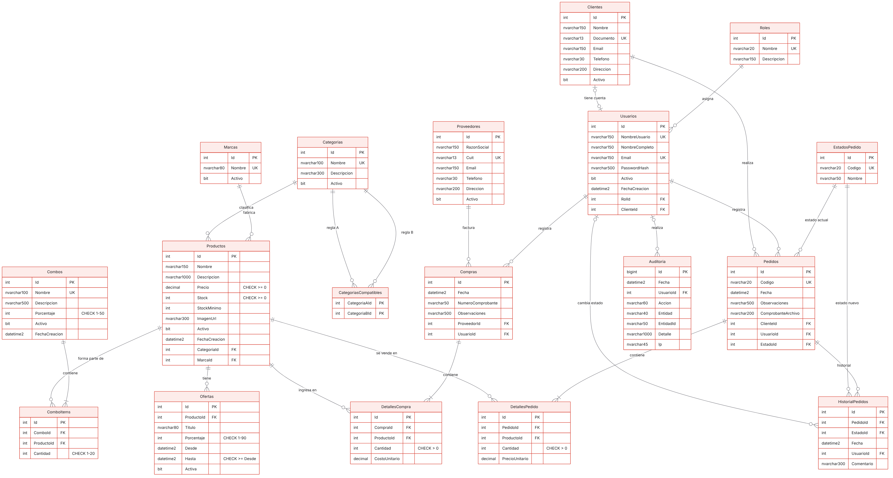
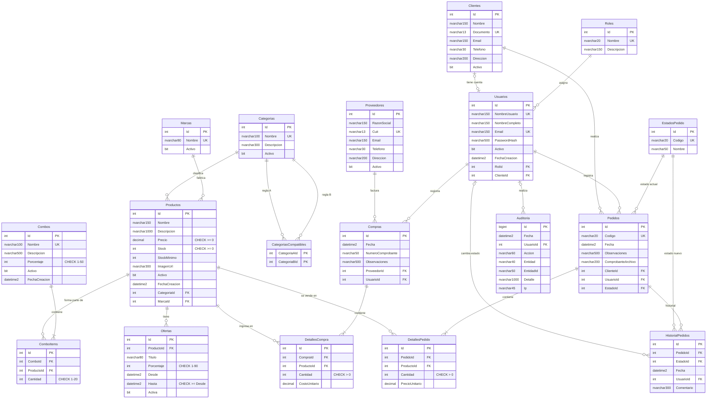

# TechHub · Modelo de datos (DER)

Base de datos **SQL Server** creada con **Entity Framework Core 10 (Code-First)**. Son **18 tablas en tercera forma normal (3FN)**.

> El mismo diagrama está en texto en [DER_TechHub.mmd](DER_TechHub.mmd) (Mermaid) y se dibuja solo en GitHub:

Convenciones: **PK** clave primaria · **FK** clave foránea · **UK** valor único. Los `CHECK` se indican junto a la columna. Notación de pata de gallo: `||` uno y solo uno, `|o` cero o uno, `o{` cero o muchos, `|{` uno o muchos.

## Tablas

| Grupo | Tabla | Qué guarda |
|---|---|---|
| Catálogo | **Categorias** | Rubros (Procesadores, Memorias RAM…). Nombre único. |
| | **Marcas** | Fabricantes (AMD, Intel, ASUS…). Nombre único. |
| | **Productos** | Componente a la venta: precio, stock, stock mínimo, imagen. |
| Personas | **Roles** | Referencia: Admin y Comprador. |
| | **Usuarios** | Cuentas de acceso (contraseña hasheada). |
| | **Clientes** | Datos del comprador (DNI/CUIT único). Un usuario comprador tiene una ficha de cliente. |
| | **Proveedores** | Mayoristas a quienes se les compra (CUIT único). |
| Compras | **Compras** | Cabecera de la factura de un proveedor. |
| | **DetallesCompra** | Renglones de la factura (suman stock). |
| Ventas | **EstadosPedido** | Referencia: Pendiente, EnRevision, Confirmado, Entregado, Cancelado. |
| | **Pedidos** | Cabecera del pedido: código, cliente, estado, comprobante de pago. |
| | **DetallesPedido** | Renglones del pedido con el precio congelado (restan stock). |
| | **HistorialPedidos** | Cada cambio de estado: quién, cuándo y por qué. |
| Promociones | **Ofertas** | Descuento temporal (porcentaje y fechas) sobre un producto. |
| | **Combos** | Paquete de productos con un descuento. |
| | **ComboItems** | Productos de un combo y su cantidad. |
| | **CategoriasCompatibles** | Reglas opcionales de compatibilidad entre categorías (hoy no se exigen al armar un combo). |
| Seguridad | **Auditoria** | Bitácora: qué operación, sobre qué entidad, quién, cuándo y desde qué IP. |

## Relaciones principales

- Una **Categoria** y una **Marca** tienen muchos **Productos** (1:N).
- Una **Compra** tiene muchos **DetallesCompra**, y cada renglón apunta a un **Producto** (N:M entre Compras y Productos resuelta con DetallesCompra).
- Un **Pedido** tiene muchos **DetallesPedido** y muchos **HistorialPedidos** (N:M entre Pedidos y Productos resuelta con DetallesPedido).
- Un **Cliente** realiza muchos **Pedidos**; un **Usuario** puede estar vinculado a un único **Cliente** (1:0..1).
- Un **Rol** tiene muchos **Usuarios**; un **EstadoPedido** se aplica a muchos **Pedidos**.
- Un **Producto** tiene muchas **Ofertas** y puede estar en muchos **Combos** (N:M resuelta con ComboItems).
- Un **Usuario** genera muchos registros de **Auditoria**.

## Normalización

- **1FN:** todas las columnas guardan un valor simple (no hay listas ni grupos repetidos). Lo que se repetía, como los productos de un pedido o de una factura, está en tablas de detalle con un renglón por producto.
- **2FN:** en las tablas de detalle cada dato depende de la clave completa de su renglón (`Cantidad` y `PrecioUnitario` dependen del renglón, no solo del pedido). Los datos del pedido (cliente, estado, fecha) viven en la cabecera y no se repiten en cada renglón. La única clave compuesta, `CategoriasCompatibles`, no tiene más columnas.
- **3FN:** no hay dependencias entre columnas que no son clave. La marca, el rol y el estado del pedido son tablas de referencia en vez de texto repetido, y los totales y subtotales no se guardan: se calculan con `Cantidad × Precio`.

## Decisiones de diseño

- **Precio congelado:** `DetallesPedido.PrecioUnitario` guarda el precio del momento de la compra (ya con la oferta o el combo aplicados). Un cambio posterior de precio no altera los pedidos anteriores.
- **Stock confiable:** el stock no se edita a mano: sube con las compras y baja con los pedidos, con una actualización condicional dentro de una transacción. Además existe `CHECK (Stock >= 0)`.
- **Ofertas sin duplicar precios:** el precio final se calcula al consultar (precio de lista y el mayor descuento vigente); no se guarda en el producto.
- **Bajas lógicas:** productos, clientes, proveedores, usuarios y combos se desactivan, no se borran (`ON DELETE RESTRICT`).
- **Trazabilidad:** `HistorialPedidos` registra los cambios de estado de cada pedido y `Auditoria` registra las operaciones de los usuarios sobre cualquier entidad.
